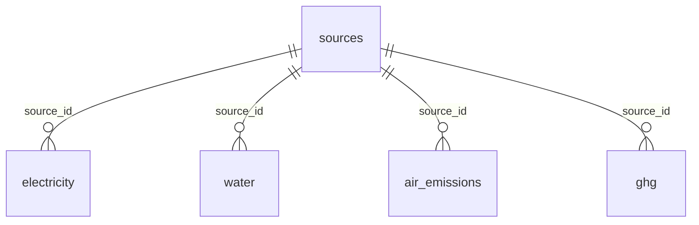

# คู่มือฐานข้อมูล Electricity ด้วย Python + SQLite

ชุดนี้ใช้ CSV ทั้งหมด 110 แถว และข้อมูลแหล่งอ้างอิง 5 แถว ไม่ใช้โปรแกรมทดลอง Apacho และไม่ต้องติดตั้ง DB Browser

## 1. ไฟล์แต่ละตัวคืออะไร

```text
electricity_project/
  README_TH.md
  schema.sql
  build_db.py
  demo.py
  electricity.db
  data/
    electricity.csv       45 แถว
    water.csv             20 แถว
    air_emissions.csv     30 แถว
    ghg.csv               15 แถว
    sources.csv            5 แหล่ง
  queries/
    counts.sql
    electricity_2567.sql
    provenance.sql
    check_duplicates.sql
  evidence/
    build_report.json
    verification.txt
```

- CSV: ข้อมูลต้นทางที่นำเข้าฐาน เก็บเป็นสำเนาเหมือน outputs/electricity_split ทุกไบต์
- schema.sql: ข้อกำหนดสร้างตาราง คีย์ และ view เป็นข้อความที่อ่านและแก้ได้
- build_db.py: Python อ่าน CSV ตรวจโครงสร้าง สร้างฐานใหม่ และนำเข้าข้อมูล
- electricity.db: ฐานข้อมูลไบนารีที่สร้างเสร็จ เปิดด้วย Python ไม่แก้ด้วยตัวแก้ไขข้อความ
- demo.py: Python เปิดฐานแบบอ่านอย่างเดียว แสดงเมนู ดูตาราง ค้นปี และรัน SQL
- queries/: คำค้น SQL ตัวอย่าง แต่ละไฟล์มีหนึ่งคำสั่งสำหรับใช้กับ demo.py
- evidence/: ผลตรวจจากการสร้างฐานและการทดสอบ

## 2. สิ่งที่ต้องมีในเครื่อง

Python 3.9 ขึ้นไป พร้อมโมดูลมาตรฐาน sqlite3 (ชุดติดตั้ง Python ทั่วไปมีให้แล้ว) ไม่ต้อง pip install ไม่ต้องมี MySQL, PostgreSQL, Docker หรือ DB Browser

เปิด Terminal แล้วตรวจ:

```powershell
python --version
python -c "import sqlite3; print(sqlite3.sqlite_version)"
```

หากเครื่องใช้คำสั่ง py แทน python ให้เปลี่ยนคำว่า python ในทุกตัวอย่างเป็น py

## 3. เริ่มใช้บนคอมตนเองหรือคอมอาจารย์

1. ดาวน์โหลดโฟลเดอร์นี้ทั้งชุดจาก GitHub และแตก ZIP ก่อน ไม่รันจากหน้าต่าง ZIP
2. เปิดโฟลเดอร์ electricity_project ใน VS Code แล้วเปิด Terminal > New Terminal หรือเปิด Terminal ในโฟลเดอร์นี้โดยตรง
3. พิมพ์คำสั่งด้านล่าง การพิมพ์คำสั่งทำใน Terminal ส่วนการแก้ไฟล์ .py/.sql ทำในพื้นที่แก้ไขไฟล์

สร้างฐานและนำเข้าทั้งหมด:

```powershell
python build_db.py
```

ผลที่ควรได้:

```text
electricity: 45 rows
water: 20 rows
air_emissions: 30 rows
ghg: 15 rows
sources: 5 rows
TOTAL: 110 observations
Integrity: ok; foreign key errors: 0; all CSV cells preserved
```

110 คือแถวข้อมูลหลัก ไม่รวม 5 แถว sources และไม่นับ view เป็นข้อมูลเพิ่ม

**คำสั่ง build_db.py สร้างฐานใหม่จาก CSV และแทนที่ electricity.db ในโฟลเดอร์นี้เมื่อสำเร็จ** การแก้ไขที่ทำเฉพาะในฐานเดิมจะไม่ถูกเก็บไว้ จึงใช้ไฟล์ CSV เป็นข้อมูลหลักของชุดนี้ หากมีฐานที่แก้ด้วยมือให้สำรองก่อน โปรแกรมสร้างฐานชั่วคราวและตรวจสำเร็จจึงเปลี่ยนไฟล์ฐาน ไม่ลบฐานเดิมก่อนนำเข้า

รันซ้ำแล้วจำนวนยังเป็น 110 เพราะสร้างใหม่จาก CSV ไม่ใช่เพิ่มข้อมูลเดิมต่อท้าย ถ้าตรวจข้อมูลไม่ผ่านจะหยุดพร้อมแจ้งปัญหา ไม่ตัดแถวทิ้งเงียบ ๆ

เริ่มสาธิต:

```powershell
python demo.py
```

เมนู:

| ปุ่ม | ทำอะไร |
| --- | --- |
| 1 | นับข้อมูลแต่ละประเภท รวม 110 และ sources 5 |
| 2 | ดูข้อมูล โดยพิมพ์ electricity / water / air_emissions / ghg |
| 3 | ค้นตามปี พ.ศ. เช่น 2567 |
| 4 | ดูรายชื่อและ URL ของแหล่งข้อมูล |
| 5 | พิมพ์ SQL หนึ่งบรรทัดเพื่อค้นข้อมูล |
| 0 | ออกจากโปรแกรม |

เปิดฐานที่ให้มาโดยไม่สร้างใหม่ก็ได้: รัน demo.py โดยตรง ถ้าไม่มีไฟล์ฐานจะแจ้งให้รัน build_db.py ก่อน ไม่สร้างฐานว่างให้โดยไม่รู้ตัว

## 4. เบื้องหลังการสร้างฐาน

ลำดับใน build_db.py:

1. ROOT = Path(__file__).resolve().parent หาโฟลเดอร์ที่เก็บไฟล์ Python ไม่ผูกกับชื่อผู้ใช้หรือไดรฟ์เดิม
2. csv.DictReader อ่านแต่ละแถวเป็นข้อมูลที่เรียกตามชื่อคอลัมน์ เช่น row['quantity']
3. ตรวจคอลัมน์ ช่องว่าง ID ซ้ำ คีย์ข้อมูลซ้ำ ปี ตัวเลข และ source_id/URL ที่ตรงกับ sources.csv
4. sqlite3.connect(...) เปิดไฟล์ฐานชั่วคราว หากไฟล์ยังไม่มี SQLite จะสร้างให้
5. conn.executescript(...) อ่าน schema.sql แล้วสร้างตารางครบทั้งหมด
6. PRAGMA foreign_keys = ON เปิดการบังคับใช้ความสัมพันธ์กับ sources ในการเชื่อมต่อนี้
7. INSERT INTO sources ... นำเข้าแหล่งอ้างอิงก่อน เพราะข้อมูลหลักต้องอ้าง source_id ที่มีอยู่
8. INSERT INTO electricity/water/air_emissions/ghg ... นำเข้าข้อมูลตามตาราง โดยใช้ ? ส่งค่าแยกจากคำสั่ง SQL
9. บันทึก ตรวจจำนวน ความสมบูรณ์ของฐาน FK และเทียบทุกช่องกับ CSV
10. ปิดการเชื่อมต่อและนำฐานที่ตรวจแล้วไปแทน electricity.db พร้อมเขียน build_report.json

schema.sql ในชุดนี้ใช้ CREATE TABLE โดยไม่มี IF NOT EXISTS เพราะโปรแกรมใช้ฐานใหม่ทุกครั้ง หากโครงสร้างเปลี่ยนก็สร้างฐานใหม่ตาม schema ปัจจุบันได้ครบ ไม่ใช่รัน IF NOT EXISTS แล้วเข้าใจว่าตารางเดิมเปลี่ยนตามแล้ว

## 5. โครงสร้างฐานจริง

มี 5 ตาราง: sources, electricity, water, air_emissions, ghg

sources มี source_id เป็น primary key อีกสี่ตารางมี id เป็น primary key ภายในแต่ละตาราง และ source_id เป็น foreign key ไป sources



ID 1 ใน electricity กับ ID 1 ใน water อยู่ร่วมกันได้ เพราะเป็นคนละตาราง เมื่ออ้างแถวข้ามทั้งโครงการให้ใช้ dataset_type + id เช่น water/1

all_observations เป็น VIEW ที่รวมผลจากทั้งสี่ตารางด้วย UNION ALL ไม่เก็บข้อมูลอีกชุด ใช้ค้นทุกประเภทในคำสั่งเดียว ห้ามบวก quantity ทุกประเภทเข้าด้วยกัน เพราะต่างหน่วย ต่าง metric และต่างขอบเขต

คอลัมน์ของแต่ละตารางข้อมูล:

| คอลัมน์ | ชนิด | ที่มา/ความหมาย |
| --- | --- | --- |
| id | INTEGER PRIMARY KEY | ID ใน CSV นั้น ต้องมากกว่า 0 |
| year_be | INTEGER | ปี พ.ศ. ตาม CSV ชุดนี้ 2563–2567 |
| category | TEXT | หมวดเดิม เก็บข้อความต้นฉบับ |
| source_id | INTEGER FK | อ้างถึง sources.source_id |
| dataset_type | TEXT | ประเภทข้อมูล ต้องตรงกับตาราง |
| scope | TEXT | ขอบเขตของตัวเลข |
| metric | TEXT | ตัวชี้วัด |
| quantity | REAL | ค่าตัวเลขสำหรับการคำนวณ SQL |
| unit_original | TEXT | หน่วยจาก CSV |
| quantity_status | TEXT | สถานะค่าตาม CSV เช่น reported ไม่ใช่ผลตรวจ verified |
| source_url | TEXT | URL เดิมจาก CSV โปรแกรมตรวจให้ตรงกับ sources |
| source_reference | TEXT | รายละเอียดแหล่งอ้างอิงตาม CSV |
| quantity_original | TEXT | สำเนาข้อความ quantity เพื่อเก็บทศนิยมตาม CSV โดยไม่ผ่าน float |

REAL เป็นเลขทศนิยมประมาณค่า ไม่รับรองความแม่นตรงทุกหลัก จึงเพิ่ม quantity_original เพื่อรักษาค่าเดิมครบ แสดงค่าจาก quantity_original และใช้ quantity เมื่อต้องคำนวณเชิงตัวเลข SQL หากต้องคำนวณแบบแม่นตรงให้ใช้ Decimal ใน Python จาก quantity_original

ใช้ unique index จาก source_id + year_be + category + scope + metric + unit_original โดยตัดช่องว่างหัวท้ายในคีย์ตรวจซ้ำ ไม่แก้ข้อความ raw ใน CSV หรือในช่องที่เก็บต้นฉบับ source_id จะแยกรุ่นรายงานได้เท่าที่ sources.csv ปัจจุบันแยกไว้

## 6. ทดลอง SQL สำหรับพรีเซนต์

ทางเลือกที่หนึ่ง: รันไฟล์คำค้นสำเร็จรูป:

```powershell
python demo.py --summary
python demo.py --year 2567
python demo.py --table water
python demo.py --sql-file queries/electricity_2567.sql
python demo.py --sql-file queries/provenance.sql
python demo.py --sql-file queries/counts.sql
python demo.py --sql-file queries/check_duplicates.sql
```

แต่ละบรรทัดคือคนละคำสั่ง กด Enter เพื่อรันทีละบรรทัด check_duplicates.sql ควรแสดง 0 rows หมายถึงไม่พบกลุ่มที่ซ้ำตามคีย์ที่ตรวจ

ทางเลือกที่สอง: เปิด demo.py เลือก 5 แล้ววาง SQL หนึ่งบรรทัด เช่น:

```sql
SELECT id, year_be, category, quantity_original AS quantity, unit_original FROM electricity WHERE year_be = 2567;
```

- SELECT ระบุคอลัมน์ที่จะดู
- FROM ระบุตาราง
- WHERE กำหนดเงื่อนไข
- AS quantity ตั้งชื่อคอลัมน์ผลลัพธ์ให้อ่านง่าย ไม่แก้ชื่อคอลัมน์จริง

ดูค่าพร้อมแหล่งอ้างอิง:

```sql
SELECT e.id, e.year_be, e.category, e.quantity_original AS quantity, e.unit_original, s.source_name, s.source_url FROM electricity AS e JOIN sources AS s ON e.source_id = s.source_id WHERE e.year_be = 2567;
```

JOIN เชื่อมสองตารางด้วย source_id ส่วน e และ s เป็นชื่อย่อของตาราง

demo.py เปิดฐานด้วย mode=ro และ query_only จึงไม่อนุญาต INSERT/UPDATE/DELETE ระหว่างพรีเซนต์ ถ้าต้องแก้ข้อมูลให้แก้ CSV แล้วรัน build_db.py เพื่อสร้างใหม่

## 7. ลำดับพรีเซนต์ที่แนะนำ

1. เปิด README อธิบายว่า CSV คือข้อมูลต้นทาง schema.sql คือแบบตาราง Python คือเครื่องมือสร้าง/ค้น และ .db คือฐานจริง
2. รัน build_db.py ให้เห็นว่าสร้างฐานและนำเข้าจากไฟล์ได้
3. รัน demo.py --summary ให้เห็น 110 แถว และแหล่งอ้างอิง 5 แถว
4. รัน electricity_2567.sql แสดงการกรองปี
5. รัน provenance.sql แสดงการเชื่อมข้อมูลกับแหล่งอ้างอิง
6. รัน check_duplicates.sql แสดงว่าไม่พบข้อมูลซ้ำตามคีย์ที่กำหนด
7. รัน build_db.py อีกครั้ง และดู summary ว่าจำนวนยังเท่าเดิม

## 8. ข้อจำกัดและการปรับให้ตรงเอกสารกลุ่ม

ชุดนี้เป็นแบบใช้งานจริงที่สร้างจาก CSV ที่ได้รับ ยังไม่ได้ตรวจว่า ERD และรายงาน PDF ของกลุ่มใช้โครงสร้างเดียวกัน ต้องเทียบและปรับให้ตรงกันก่อนส่ง

นำเข้าข้อมูลทั้งหมดตามที่ผู้ใช้กำหนด ไม่แก้ตัวเลข สถานะ หน่วย หรือข้ออ้างอิงในต้นฉบับ โปรแกรมตรวจโครงสร้างและการนำเข้า ไม่ใช่การตรวจรับรองตัวเลขกับเอกสาร กฟผ. ใหม่ และไม่ถือว่า reported เท่ากับ verified

หากแก้ข้อมูลใน outputs/electricity_split ภายหลัง ต้องปรับสำเนาใน data/ ให้เป็นรุ่นเดียวกันก่อนสร้างฐานใหม่ อย่าแก้ไฟล์สองที่สลับกันโดยไม่ตรวจรุ่น

ไม่จำเป็นต้องติดตั้งเว็บหรือ DB Browser บนคอมอาจารย์ เมื่อมี Python พร้อม sqlite3 และดาวน์โหลดไฟล์ทั้งชุดครบแล้ว หลังดาวน์โหลดสามารถสาธิตออฟไลน์ได้ ยกเว้นการเปิด URL ของต้นทาง

## 9. ถ้าเกิดข้อผิดพลาด

- python ไม่พบ: ลอง py หรือใช้ตำแหน่ง Python ที่ติดตั้งในเครื่องนั้น
- can't open file build_db.py: Terminal อยู่ผิดโฟลเดอร์ ให้เปิดใน electricity_project
- No module named sqlite3 หรือ _sqlite3: Python ชุดนั้นไม่มี SQLite ต้องใช้ชุดติดตั้งที่มีโมดูลนี้
- Database missing: รัน python build_db.py ก่อน
- Build failed: อ่านชื่อไฟล์และ ID ที่แจ้ง แก้ CSV ที่เกี่ยวข้องแล้วรันใหม่ ฐานเดิมยังไม่ถูกแทนหากล้มเหลวก่อนเปลี่ยนไฟล์
- Permission denied ตอนแทนฐาน: ปิดโปรแกรมอื่นที่เปิด electricity.db อยู่และลองใหม่
- เปิด .db แล้วเห็นอักขระแปลก: ปิดแท็บโดยไม่บันทึก แล้วใช้ demo.py เปิดฐาน
